# Exploratory-Data-Analysis-with-R
README
================

install.packages(c(“rmarkdown”, “tidyverse”, “nycflights13”))

## R Markdown

This is an R Markdown document. Markdown is a simple formatting syntax for authoring HTML, PDF, and MS Word documents. For more details on using R Markdown see <http://rmarkdown.rstudio.com>.

When you click the **Knit** button a document will be generated that includes both content as well as the output of any embedded R code chunks within the document. You can embed an R code chunk like this:

``` r
summary(cars)
```

    ##      speed           dist       
    ##  Min.   : 4.0   Min.   :  2.00  
    ##  1st Qu.:12.0   1st Qu.: 26.00  
    ##  Median :15.0   Median : 36.00  
    ##  Mean   :15.4   Mean   : 42.98  
    ##  3rd Qu.:19.0   3rd Qu.: 56.00  
    ##  Max.   :25.0   Max.   :120.00

## Including Plots

You can also embed plots, for example:

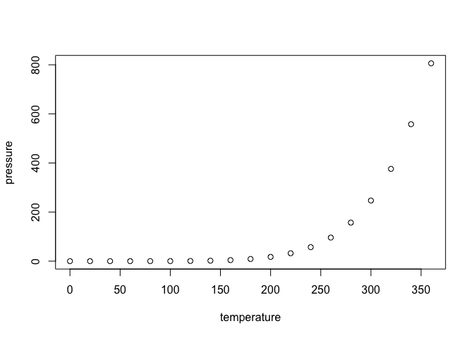<!-- -->

Note that the `echo = FALSE` parameter was added to the code chunk to prevent printing of the R code that generated the plot.

# Exploratory Data Analysis with R

## Section 10.3.3 Exercises

### Question 1 Diamond Dimensions

**Answer:** Looking at the three histograms, I noticed that most diamonds have x and y dimensions between about 4 and 9 mm, while the z dimension is generally smaller, around 2.5 to 5.5 mm. All three distributions have most of their values concentrated toward the lower end, with fewer diamonds having larger dimensions. I also noticed some unusual values in the y and z distributions, which could be errors in the data.

The x and y variables likely represent the length and width of the diamond because they have similar distributions, while z represents the depth because it is generally smaller. The difference between length and width would depend on how the diamond is positioned or measured.

Write your explanation here.

``` r
library(tidyverse)

ggplot(diamonds, aes(x = x)) +
  geom_histogram(binwidth = 0.2)
```

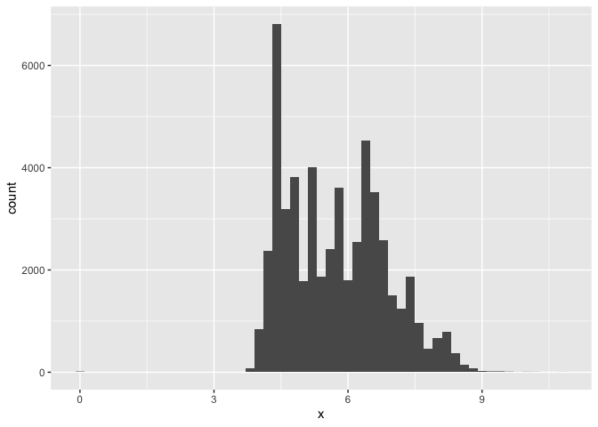<!-- -->

``` r
ggplot(diamonds, aes(x = y)) +
  geom_histogram(binwidth = 0.2)
```

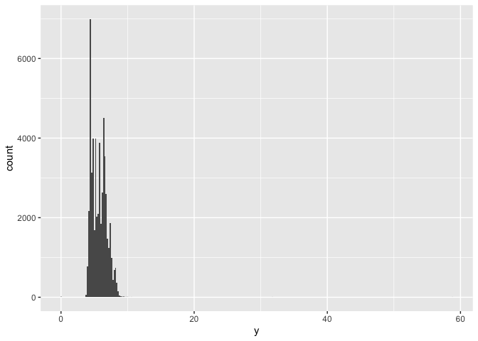<!-- -->

``` r
ggplot(diamonds, aes(x = z)) +
  geom_histogram(binwidth = 0.2)
```

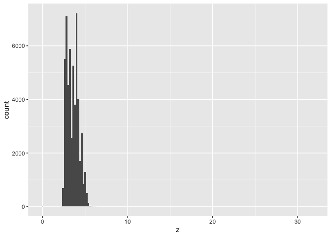<!-- -->

### Question 2 Price Distribution

**Answer:** Looking at the three histograms, I noticed that diamond prices are right-skewed, with most diamonds concentrated at lower prices and fewer diamonds at higher prices. When I used a larger binwidth of 1000, the distribution looked relatively smooth. However, as I decreased the binwidth to 100 and then 25, I noticed more variation in the prices. The most surprising observation was a clear gap around \$1,500 where there were almost no diamonds. The smaller binwidth also revealed several peaks that were harder to see in the first graph. Overall, changing the binwidth helped me identify patterns that were hidden when the prices were grouped into larger intervals.

``` r
ggplot(diamonds, aes(x = price)) +
  geom_histogram(binwidth = 1000)
```

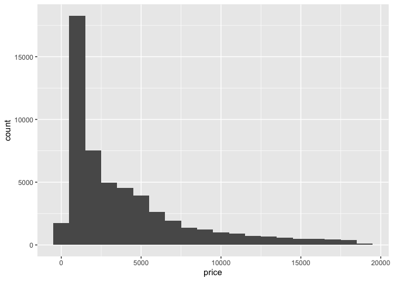<!-- -->

``` r
ggplot(diamonds, aes(x = price)) +
  geom_histogram(binwidth = 100)
```

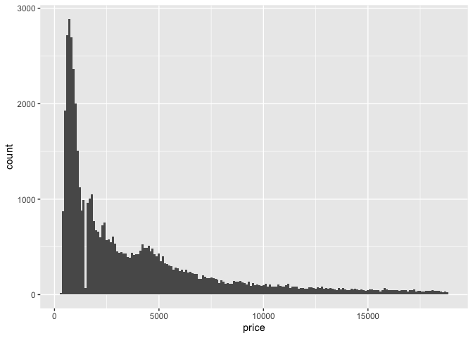<!-- -->

``` r
ggplot(diamonds, aes(x = price)) +
  geom_histogram(binwidth = 25)
```

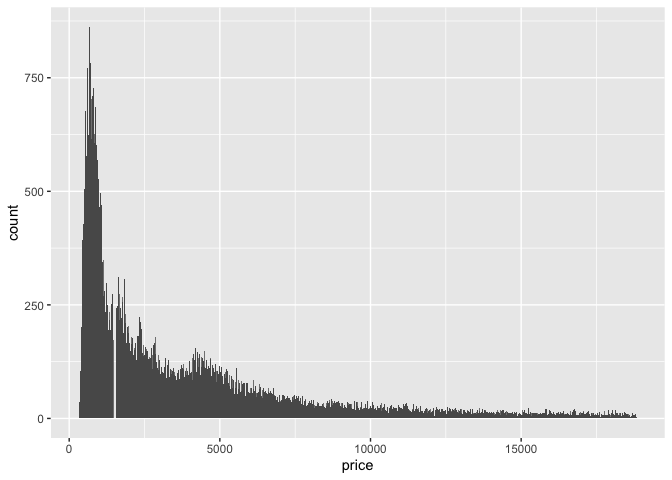<!-- -->

### Question 3 0.99 vs. 1 Carat Diamonds

**Answer:** There are 23 diamonds that weigh 0.99 carats and 1,558 diamonds that weigh exactly 1 carat. This is a very large difference considering the weights are so close together. I think the main reason is that 1 carat is an important benchmark for diamond prices. Diamonds that reach exactly 1 carat are generally more valuable and desirable than diamonds just under that weight. Because of this, diamond cutters may try to keep diamonds at or above 1 carat rather than cutting them down to 0.99 carats. This could explain why there are so many more diamonds at 1 carat.

``` r
diamonds |>
  filter(carat == 0.99 | carat == 1.00) |>
  count(carat)
```

    ## # A tibble: 2 × 2
    ##   carat     n
    ##   <dbl> <int>
    ## 1  0.99    23
    ## 2  1     1558

### Question 4 coord_cartesian() vs. xlim()

**Answer:** After comparing the histograms, I noticed that `coord_cartesian()` and `xlim()` both allow you to zoom in, but they work differently. `coord_cartesian()` only changes what portion of the graph is visible without removing any data. However, `xlim()` removes observations outside the selected range, which can change the histogram and the number of observations counted in each bar. `ylim()` can also cause bars to be removed if their heights exceed the limits.

When I left binwidth unset, R automatically used 30 bins. This caused differences between the graphs because `xlim()` changes the range of data used to calculate the bins, while `coord_cartesian()` does not. When I zoomed in so only half a bar was visible, `coord_cartesian()` displayed the portion of the bar within the selected range. With `xlim()`, the data was filtered instead, which could change or remove the bar. Overall, `coord_cartesian()` is better when you want to zoom in without changing the underlying distribution.

``` r
# Original histogram
ggplot(diamonds, aes(x = price)) +
  geom_histogram(binwidth = 500)
```

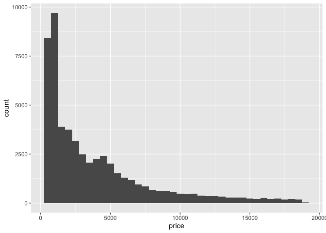<!-- -->

``` r
# Zoom using coord_cartesian()
ggplot(diamonds, aes(x = price)) +
  geom_histogram(binwidth = 500) +
  coord_cartesian(xlim = c(0, 5000))
```

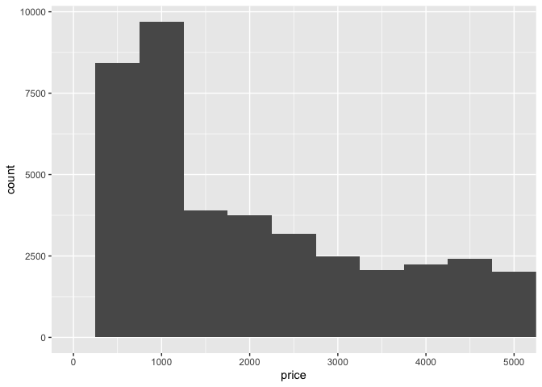<!-- -->

``` r
# Zoom using xlim()
ggplot(diamonds, aes(x = price)) +
  geom_histogram(binwidth = 500) +
  xlim(0, 5000)
```

    ## Warning: Removed 14714 rows containing non-finite outside the scale range
    ## (`stat_bin()`).

    ## Warning: Removed 2 rows containing missing values or values outside the scale range
    ## (`geom_bar()`).

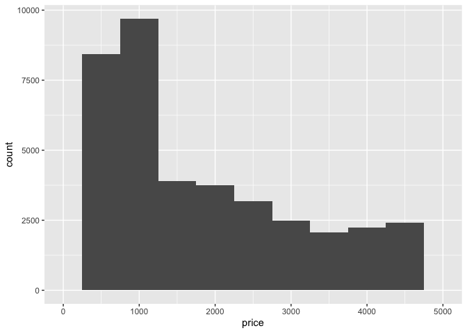<!-- -->

``` r
# No binwidth using coord_cartesian
ggplot(diamonds, aes(x = price)) +
  geom_histogram() +
  coord_cartesian(xlim = c(0, 5000))
```

    ## `stat_bin()` using `bins = 30`. Pick better value `binwidth`.

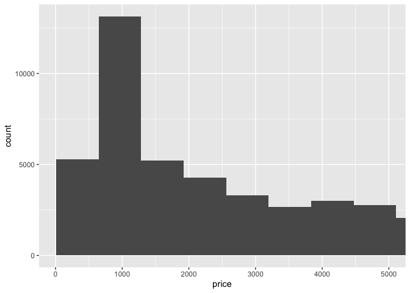<!-- -->

``` r
# No binwidth using xlim
ggplot(diamonds, aes(x = price)) +
  geom_histogram() +
  xlim(0, 5000)
```

    ## `stat_bin()` using `bins = 30`. Pick better value `binwidth`.

    ## Warning: Removed 14714 rows containing non-finite outside the scale range
    ## (`stat_bin()`).
    ## Removed 2 rows containing missing values or values outside the scale range
    ## (`geom_bar()`).

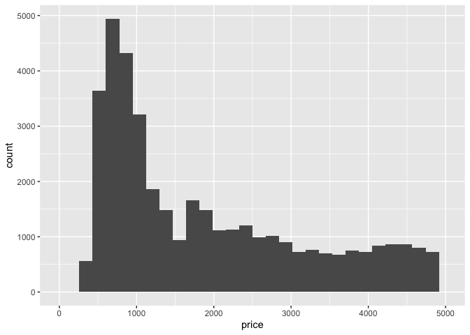<!-- -->

## Section 10.4.1 Exercises

### Question 1

**Answer:** When comparing the histogram and bar chart, I noticed that missing values are handled differently. In the histogram, missing values are removed because they do not have a numerical value that can be placed into a bin. However, in the bar chart, missing values appear as their own category labeled NA. I think the reason for this difference is that histograms represent continuous numerical data, while bar charts represent categorical data. Since a missing value can be treated as a category but cannot be assigned a numerical position, the two graphs handle missing values differently.

``` r
# Create a dataset with missing values
example_data <- tibble(
  value = c(1, 2, 3, 4, 5, NA),
  category = c("A", "A", "B", "B", NA, "C")
)

# Histogram with missing values
ggplot(example_data, aes(x = value)) +
  geom_histogram(binwidth = 1)
```

    ## Warning: Removed 1 row containing non-finite outside the scale range
    ## (`stat_bin()`).

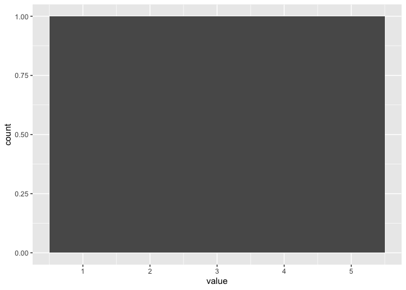<!-- -->

``` r
# Bar chart with missing values
ggplot(example_data, aes(x = category)) +
  geom_bar()
```

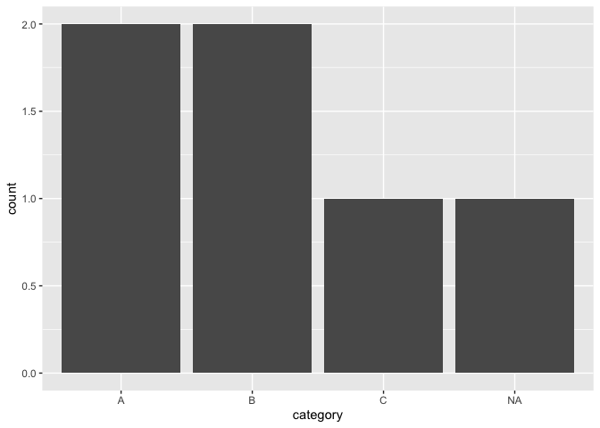<!-- -->

### Question 2

**Answer:** When using `mean()` and `sum()`, setting `na.rm = TRUE` tells R to ignore missing values when performing calculations. Without it, both functions return NA if there is a missing value in the dataset. In my example, the mean and sum originally returned NA, but after adding `na.rm = TRUE`, the mean was 5 and the sum was 20. This is useful because it allows us to calculate results using the available data without missing values affecting the entire calculation.

``` r
# Create data with a missing value
numbers <- c(2, 4, 6, 8, NA)

# Mean without removing NA
mean(numbers)
```

    ## [1] NA

``` r
# Mean with NA removed
mean(numbers, na.rm = TRUE)
```

    ## [1] 5

``` r
# Sum without removing NA
sum(numbers)
```

    ## [1] NA

``` r
# Sum with NA removed
sum(numbers, na.rm = TRUE)
```

    ## [1] 20

### Question 3

**Answer:** Looking at the frequency plots, I noticed that there are significantly more non-cancelled flights than cancelled flights. In the original graph, it was difficult to see the distribution of cancelled flights because there were so few compared to non-cancelled flights. When I used `facet_wrap()`, the two groups were separated into different graphs, making them easier to compare. With fixed scales, the cancelled flights were still difficult to see because both graphs shared the same y-axis scale. However, when I changed the scales to `"free_y"`, it became much easier to see the cancelled flights because each graph had its own y-axis scale. Using `"free"` also made the distributions easier to see, but it allowed both axes to change. Overall, I think `"free_y"` was the best option because it made both distributions visible while keeping the same departure-time scale for comparison.

``` r
library(nycflights13)

# Prepare the flight data
flights2 <- flights |>
  mutate(
    cancelled = is.na(dep_time),
    sched_hour = sched_dep_time %/% 100,
    sched_min = sched_dep_time %% 100,
    sched_dep_time = sched_hour + sched_min / 60
  )

# Original frequency plot
ggplot(flights2, aes(x = sched_dep_time,
                     color = cancelled)) +
  geom_freqpoly(binwidth = 1/4)
```

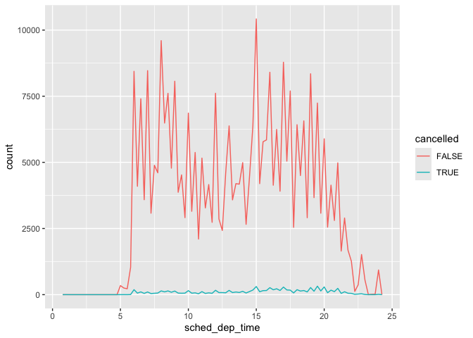<!-- -->

``` r
# Facet with fixed scales
ggplot(flights2, aes(x = sched_dep_time,
                     color = cancelled)) +
  geom_freqpoly(binwidth = 1/4) +
  facet_wrap(~cancelled, scales = "fixed")
```

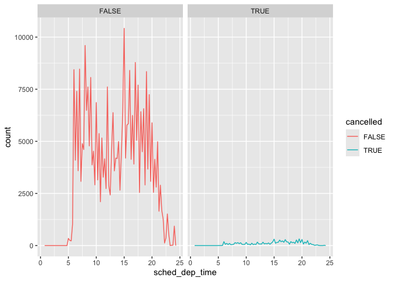<!-- -->

``` r
# Facet with free y-axis
ggplot(flights2, aes(x = sched_dep_time,
                     color = cancelled)) +
  geom_freqpoly(binwidth = 1/4) +
  facet_wrap(~cancelled, scales = "free_y")
```

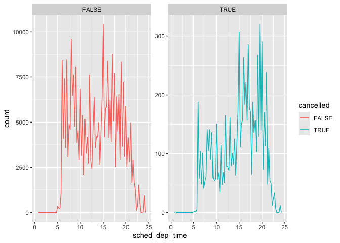<!-- -->

``` r
# Facet with both scales free
ggplot(flights2, aes(x = sched_dep_time,
                     color = cancelled)) +
  geom_freqpoly(binwidth = 1/4) +
  facet_wrap(~cancelled, scales = "free")
```

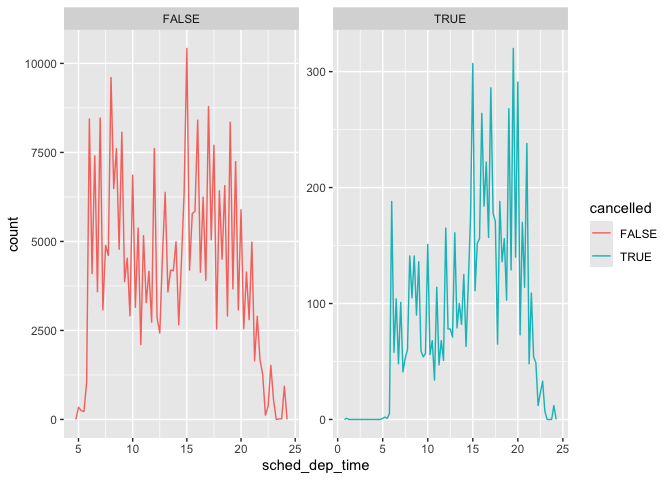<!-- -->
